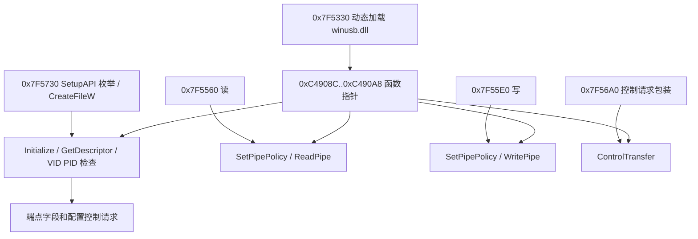

# Manager ↔ Accessport 通信分析

样本：APManager.exe 3.2.0，SHA-256 `6c4361ed96f75951185a7dfb9d4376234a4a7d594bcc2f28a0f29fa6640c404f`。本项目没有 Accessport、USB 抓包或车辆连接。「已验证」在本文指文件/静态代码事实，不指硬件通信成功。

## 驱动和识别

**已验证（INF）**：`samples/extracted/drivers/accessport.inf` 注册 COBBDevices 类 `{4e7842fa-ddb1-47f3-bc73-10c613de4d29}`、设备接口 GUID `{69663630-e19c-4b71-83aa-bd17a5bd4b83}`，包含 `winusb.inf` / `WINUSB.NT`、WinUSB.sys 和 x86/amd64 coinstaller。

| VID | PID | INF 显示名称 | 证据边界 |
|---|---|---|---|
| 1A84 | 0120 | AccessPORT 2.0 W | INF 声明，不代表本次发现实体设备 |
| 1A84 | 0121 | AccessPORT 2.0B W | 同上 |
| 1A84 | 0210 | USB to OBD Cable (FTDI) W | 同上，不能把线缆名字当成 Manager 实现车辆刷写的证据 |
| 1A84 | 0211 / 0213 | USB to OBD Cable (Atmel) W | 同上 |
| 1A84 | 0212 | COBB USB to OBD Cable (SS) | `Cobb_OBDFTDI.INF` 的另一条 FTDI 总线驱动路径 |

**已验证（文件）**：旧 `AP_20.inf` 为上述部分设备登记 libusb0 服务；包里有 libusb0.dll/.sys、FTD2XX.dll、ftdibus.sys、FTBUSUI.dll。这些是安装包携带的兼容组件，不能据此假设主程序同时使用全部驱动。没有安装它们。INF 中没有列出可直接归属 AP3-POR-007 的型号标识；不能把 AP2 列表当成 AP3 的完整 PID 表。

**已验证（PE 与反编译）**：APManager.exe 导入 SetupDiGetClassDevsW、SetupDiEnumDeviceInterfaces、SetupDiGetDeviceInterfaceDetailW、SetupDiDestroyDeviceInfoList，以及 LoadLibraryA/W、GetProcAddress、CreateFileA/W、ReadFile、WriteFile。WinUsb_* 不在普通 PE 导入表中；`0x7F5330` 的真实代码通过 `LoadLibraryW(L"winusb.dll")` 和 `GetProcAddress` 绑定它们。该结论已由下面的函数体与指针调用交叉核实，不再仅依赖字符串。

## 初始化、传输与错误

以下地址为原始 PE 的首选 VA，ImageBase 为 `0x400000`，不是运行时 ASLR 地址。`FUN_*` 是 Ghidra 自动名称；用途说明来自本次静态阅读，不是声称恢复了原始函数名。REA/Ghidra 12.1.4 的五份实际反编译结果足以建立此 WinUSB 分支的装载、枚举、读写与控制传输链。

### 动态绑定

**已验证（`0x7F5330`）**：对象先写入 `CobbUSBDevice::vftable`，再写入 `WinUSBDevice::vftable`；文件句柄字段 `+0x10` 初始化为 `-1`，接口句柄字段 `+0x28` 初始化为零。模块句柄存放于 `0xC49084`，函数指针如下：

| 全局指针 VA | GetProcAddress 名称 | 本次已见调用 |
|---|---|---|
| `0xC4908C` | `WinUsb_Initialize` | `0x7F5730` |
| `0xC49090` | `WinUsb_Free` | 已绑定，本文五个函数不包含其实际调用 |
| `0xC49094` | `WinUsb_GetDescriptor` | `0x7F5730` |
| `0xC49098` | `WinUsb_WritePipe` | `0x7F55E0` |
| `0xC4909C` | `WinUsb_ReadPipe` | `0x7F5560` |
| `0xC490A0` | `WinUsb_SetPipePolicy` | `0x7F5560`、`0x7F55E0` |
| `0xC490A4` | `WinUsb_GetPipePolicy` | 已绑定，本文五个函数不包含其实际调用 |
| `0xC490A8` | `WinUsb_ControlTransfer` | `0x7F5730`、`0x7F56A0` |

任一必要符号缺失会触发 `FreeLibrary`，将模块句柄清零；装载失败路径置 `0xC49088` 为 1。构造函数只在模块句柄为零且该标志为零时尝试装载。这里只证明这段初始化的失败分支，不能据此断言整个程序不存在其他恢复入口。

### 枚举、打开和描述符检查

**已验证（`0x7F5730`）**：调用 `SetupDiGetClassDevsW` 时使用标志 `0x12`，随后依次调用 `SetupDiEnumDeviceInterfaces`、两阶段 `SetupDiGetDeviceInterfaceDetailW` 取得接口路径。它向 `CreateFileW` 传入访问 `0xC0000000`、共享 `3`、打开方式 `3`、标志 `0x40000080`；打开失败会尝试后续接口。成功后通过 `0xC4908C` 初始化 WinUSB 接口句柄。

**已验证（原始字节）**：枚举所用 GUID 指针是 VA `0xB1D0C4`（RVA `0x71D0C4`，文件偏移 `0x71BCC4`）。直接从原始 PE 读取的 16 字节为：

```text
30 36 66 69 9c e1 71 4b 83 aa bd 17 a5 bd 4b 83
```

按 Windows GUID 字段字节序解析为 `{69663630-e19c-4b71-83aa-bd17a5bd4b83}`，与 `accessport.inf` 的 DeviceInterfaceGUIDs 完全一致。这把 INF 与实际枚举代码连接起来。

**已验证（代码），文档支持（字段解释）**：`WinUsb_GetDescriptor` 以类型 `1`、索引 `0`、语言参数 `0x409` 请求 `0x12` 字节，写入对象 `+0x14`。代码将对象 `+0x1C` 和 `+0x1E` 的两个 16 位值分别与函数的 `param_1`、`param_2` 比较；它们对应设备描述符内偏移 8 的 `idVendor` 与偏移 10 的 `idProduct`。对象 `+0x25` 是描述符偏移 17 的 `bNumConfigurations`。[Microsoft 设备描述符字段表](https://learn.microsoft.com/en-us/windows-hardware/drivers/network/device-descriptor)

VID/PID 不匹配或描述符调用失败时，代码调用对象虚表 `+0x10` 槽并返回 0；该槽在本文范围内未进一步确认，不能把它命名为已验证的完整清理函数。此函数按调用者参数检查 VID/PID；本文没有从该函数恢复全部调用参数，因此没有得到 AP3 的完整 PID 表。

**已验证（`bNumConfigurations` 分支）**：下表记录代码硬编码的端点号和对象值，不能冒充硬件返回的端点描述符。

| 描述符值 | 读端点字段 `+0x04` | 写端点字段 `+0x08` | 字段 `+0x0C` | 后续控制传输 |
|---|---|---|---|---|
| `< 3` | `0x81` | `0x02` | `0x40` | 本函数直接成功返回 1 |
| `== 4` | `0x82` | `0x03` | `0x200` | 设置包前四字节 `00 09 03 00`，其余为零 |
| `>= 3` 且 `!= 4` | `0x81` | `0x02` | `0x40` | 设置包前四字节 `00 09 02 00`，其余为零 |

控制传输使用 `0xC490A8` 指针；成功返回 1，失败调用 `GetLastError` 后返回 0。没有实物确认这些分支分别对应哪一代 Accessport，也未证明字段 `+0x0C` 就等于实际端点最大包长。

### 读写、超时与控制请求

**已验证（`0x7F5560` / `0x7F55E0`）**：两个方法首先检查接口句柄 `+0x28`。读方法取 `+0x04` 端点，写方法取 `+0x08` 端点；两者先通过 `0xC490A0` 设置 policy `3`、长度 `4`，值来自第三个参数，再调用各自的 ReadPipe / WritePipe 指针，传入缓冲区、请求长度、实际传输长度指针和空 Overlapped。

**文档支持**：WinUSB policy `0x03` 是 `PIPE_TRANSFER_TIMEOUT`，值以毫秒计；因此这里的第三参数是所选端点的传输超时时间。[Microsoft WinUSB 管道策略](https://learn.microsoft.com/en-us/windows-hardware/drivers/usbcon/winusb-functions-for-pipe-policy-modification)

**已验证（返回路径）**：读取或写入成功时返回实际字节数。底层传输失败后若 `GetLastError() == 0x79`，返回 `-0x74`，即 `-116`；其他传输失败、设置策略失败或无接口句柄返回 `-1`。**文档支持**：Windows 错误 `121 / 0x79` 为 `ERROR_SEM_TIMEOUT`。[Microsoft 系统错误码](https://learn.microsoft.com/en-us/windows/win32/debug/system-error-codes--0-499-)

这里证明了超时错误的转换，尚未证明上层把 `-116` 显示为什么消息、是否重试，或发生部分传输时应用怎样恢复。不可仅因 `-116` 的数值与其他平台约定相似，就断言程序复用了某个未经验证的错误码体系。

**已验证（`0x7F56A0`）**：通用控制传输包装方法将前四个参数打包为两个 32 位设置字段：第一字段含两个 8 位值和一个 16 位值；第二字段包含第四个 16 位参数及第六参数的低 16 位。第五参数作为缓冲区，第六参数同时作为请求长度，最后参数为空 Overlapped。调用已确认绑定的 `WinUsb_ControlTransfer` 指针后，成功返回传输字节数，失败或接口句柄为空返回 `0xFFFFFFFF`。此处恢复的是 USB 控制请求包装结构，没有恢复 COBB 上层命令字、响应包或车辆协议。



图表示对象字段和已绑定函数指针构成的静态依赖，不表示已捕获的现场调用时间线。

### 上层后端选择与分块发送

**已验证（`0x7F33D0`，结合 `0x7F3270` 构造与原始指令）**：通信聚合对象保留活动后端指针，依次考虑偏移 `+0x04` 的 WinUSB 和 `+0x30` 的 LibUSB 两个内嵌后端。它先通过候选对象虚表 `+0x14` 检查可用性，再通过 `+0x0C` 槽传入两个设备识别参数打开设备；成功后调用 `+0x18` 槽，结果保存至聚合对象 `+0x50`。最终失败返回 `0xFFFFFFFF`；缺少通信支持的分支置全局标志 `0xC49040`，显示 `COBB Communications Error`，消息明确提到 WinUSB / libusb 支持。

后端名称和顺序有独立的构造指令证据：`0x7F32B1` 是 `lea ecx,[esi+4]`，`0x7F32BA` 调用已确认的 WinUSB 构造函数 `0x7F5330`；`0x7F32C3` 是 `lea ecx,[esi+0x30]`，`0x7F32C6` 调用 `0x7F59C0`。后者在 `0x7F59F7` 写入虚表指针 `0xB1D1D4`，与 `rtti_vtable_candidates.json` 的 `LibUSBDevice` 表一致。这里恢复了 WinUSB 优先、LibUSB 后备的静态路径，没有实测后备驱动通信。

聚合对象构造函数 `0x7F3270` 先分配 `0x5C` 字节，将 `+0x54` 初始化为 `7000`。打开成功后，若产品参数为 `0x0120`，该字段写入 `7000`；为 `0x0210` 写入 `0x226`（550）；为 `0x0211` 写入 `5000`；其他产品值在打开方法这段分支中不改写该字段。后续分块发送将此字段作为底层写方法的超时参数。这不是全部 Accessport 型号表；此处的特殊产品分支不能直接证明 AP3-POR-007 的设备 PID。

**已验证（`0x7F35E0`）**：发送包装方法取活动后端对象 `+0x0C` 的数值作为分块上限，每轮发送 `min(剩余长度, 上限)`，通过活动后端虚表首槽调用底层写方法；本次 WinUSB 虚表首槽对应已反编译的 `0x7F55E0`。实际写入数为正时推进偏移，因此短写会继续发送剩余数据。可观察的错误与结束分支如下：

| 条件 | 行为 |
|---|---|
| 底层返回 `-5` | 立即设置通信聚合对象 `+0x58` 字节标志为 1，返回 `0xFFFFFFFF`；未确认该标志的完整上层含义 |
| 其他负返回值，包括 WinUSB 超时转换值 `-116` | 累计负返回计数；累计达到 6 次后返回 `0xFFFFFFFF` |
| 成功完成目标长度且累计负返回少于 6 次 | 返回请求长度 |
| 第四参数低字节非零、请求长度为正且恰为分块上限的整数倍 | 递归调用一次零长度发送，随后仍返回原请求长度 |

负返回计数不会因一次正返回而清零，因此这是“累计最多 6 个负返回”，不是“最多 6 次发送”或“每块重试 6 次”。`-5` 在计数前立即退出，和可计数的 `-116` 超时分支不同。持续返回零不会推进偏移，也不增加该负返回计数；这段代码本身没有显示这种情形的总次数上限。

零长度分支支持“请求以零长度 USB 传输结束”的解释；这里已验证的是代码尝试该写调用。递归调用的返回值没有传播，所以不能声称零长度传输实际成功，更不能声称观察到硬件 ZLP。尚未确认此选项对所有后端和设备的实际效果。

### 接收帧结构的有限恢复

**已验证（`0x7F3720`）**：`usb::USBCommunicator::vftable` 构造路径调用 `0x7F3270`，随后将对象 `+0x08` 字节清零、`+0x0C` 写为 `0x800`、`+0x10` 的 16 位值写为 `0x0200`。这些是静态初值，没有运行设备握手。

**已验证但覆盖不完整（`0x7F38B0`）**：接收路径通过 `0x7F3520` 获取字节。负返回且不为 `-116` 时直接退出当前读取尝试；`-116`、零返回或未满足可选前缀检查的正返回可继续，循环局部计数上限为 6。对象状态字节 `+0x08` 为零时不要求接收缓冲区以 `C0 BB` 开头；只有该状态非零时才检查这两个字节。后面向累积缓冲区追加数据前也存在同样的条件。**不能把 `C0 BB` 写成所有 Accessport 包的通用前缀。**

从缓冲区加上对象 `+0x10` 低字节给出的偏移处，代码复制 7 字节作为首部，逐字段读取如下：

| 首部偏移 | 已观察的用途 |
|---|---|
| `0` | 保存到单字节 tag 变量；结束路径可比较 tag 是否为 2，但尚未恢复完整含义 |
| `1..4` | 构造长度值 `L`，非零时设置预计累计长度 `L + 7` |
| `5` | 标志字节；可见代码测试 `0x04` 与 `0x08` 位并进入不同路径，完整语义未知 |
| `6` | 到此位置跳转结束首部字段循环，尚无确定的语义解释 |

**已验证（字节序）**：长度循环先使指针指向偏移 5，再逐次前移后读取偏移 `4,3,2,1`，位移量依次为 `0,8,16,24`。因此观察到的公式为 `L = h[4] | (h[3] << 8) | (h[2] << 16) | (h[1] << 24)`，即首部偏移 `1..4` 按大端顺序存放；不能误记为小端。这只是该接收路径的字段读取证据，不是对整个设备协议字节序的概括。

状态字节 `+0x08` 非零且 tag 为 2 的结束路径会将该状态清零、`+0x0C` 改为 `0x800`、`+0x10` 的 16 位值改为 `0x0200`。另有标志相关的数据流变换和分块处理，但本次不读取潜在受保护常量地址 `0xB1D06C` 的内容，也不将其引用解释成已恢复算法或授权机制。

**覆盖限制**：此函数反编译明确提示移除了 `0x7F471C`、`0x7F473A`、`0x7F474C`、`0x7F475C`、`0x7F4762` 等块，部分调用被标记为不返回。可见代码也包含未恢复来源的局部值。因此上述首部字段、条件分支与调用是有限静态观察；完整响应状态机、所有标志路径、完成返回和错误恢复仍不能由此伪代码完整重建。需要结合原始指令和补充定向分析后才能扩展结论。

**未知（硬件）**：真实设备枚举结果、端点描述符、握手字节、命令/响应现场顺序、USB 分包时序、拔线/超时重试行为、设备对返回值的实际解释。禁止从静态常量编造通信记录。

**未知（上层协议）**：文件上传 / 下载的 COBB 命令号、完整首部语义、校验字段、完整响应状态机、固件分块及设备侧执行逻辑。首部长度字段、部分标志测试及发送分块已获得有限静态证据；不能升级为“已重建 Accessport 文件协议或 Porsche ECU / PDK 刷写协议”。其他兼容驱动分支也未全部反编译。

## 证据入口

- 文件级完整导入/导出、架构和资源：`analysis/pe_metadata/extracted/manager/APManager.exe.json`。
- 有偏移/VA 的字符串：`analysis/strings/extracted/manager/APManager.exe.json`；关键词集合包含测试夹具和公共 UI 资源，不能作独立实现证明。
- 驱动包内容：`analysis/sources/driver_archive_listing.txt`，所有文件哈希：`samples_manifest.json`。
- 官方职责与车辆侧边界：`official_documentation.md`。正常架构的 Accessport ↔ 车辆一段有文档支持，本次未观测。

以下是实际 REA/Ghidra 反编译证据标识，均对应同一原始 APManager.exe 哈希：

| 原始 VA | 文件（相对 `analysis/ghidra/`） | evidence_id |
|---|---|---|
| `0x7F5330` | `decompile_0x7f5330.json` | `ev_c82cb837ab81969b25527c94a3e68069f814ab5bb2b2143ca62c904438bc151f` |
| `0x7F5730` | `decompile_0x7f5730.json` | `ev_a13c04efff2f9d5429ee680097013268e8774a59a8ad0f21043668a88bbb0e64` |
| `0x7F5560` | `decompile_0x7f5560.json` | `ev_ed83c1493b7db0eadc3c87fb978546fb82bf294cc5ab284bebe6c42567151d48` |
| `0x7F55E0` | `decompile_0x7f55e0.json` | `ev_61b4584c460ba39397699c067d26cf5960560034cec0634a1b33ebaf44d2a95d` |
| `0x7F56A0` | `decompile_0x7f56a0.json` | `ev_5230efcaf34c9c226ea936000e9f40ebbf6796f62f11d4037f0deab9dbcfa880` |
| `0x7F33D0` | `decompile_0x7f33d0.json` | `ev_c663325d2e3b3b61f90139a72c012e02e8c527794db835a1a418ddcc12187fe2` |
| `0x7F35E0` | `decompile_0x7f35e0.json` | `ev_c3de1950d88936468136f8d0c07829d1923e16a4431d8a4337388db85971c0a5` |
| `0x7F38B0` | `decompile_0x7f38b0.json` | `ev_dbdfba00c3d50f89e5bf63c099927ee282621a1611a1a9fb2cc8c8f402bf811c` |
| `0x7F3720` | `decompile_0x7f3720.json` | `ev_1c0728a3ef5f3f6a66bbc91ed074c2f7fa87a496abc55726dc02d710a0e3aeb4` |
| `0x7F3270` | `decompile_0x7f3270.json` | `ev_77c5b281b2e1664b6fbb9f788b95491f534b9bd2041f816f8718e58e141f40bf` |

反编译是 Ghidra 的类型与控制流恢复结果，非原始 C++ 源码；间接调用的 API 名称通过构造函数的 GetProcAddress 赋值跨函数还原。本次确证范围限于这些有效输出。默认分析对部分固件根函数的识别仍不完整，不能从“未识别函数”推导“代码不存在”；后续定向分析应独立补充上层协议和更新链证据。
